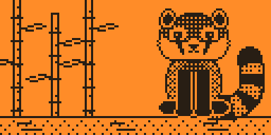
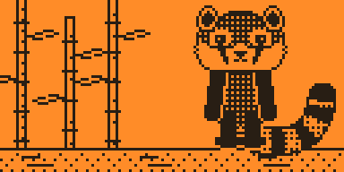
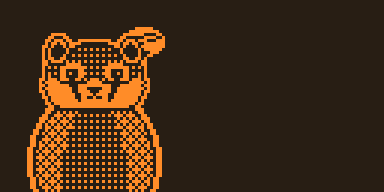
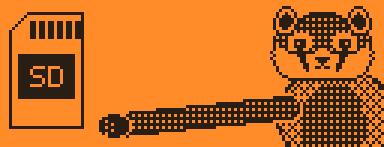
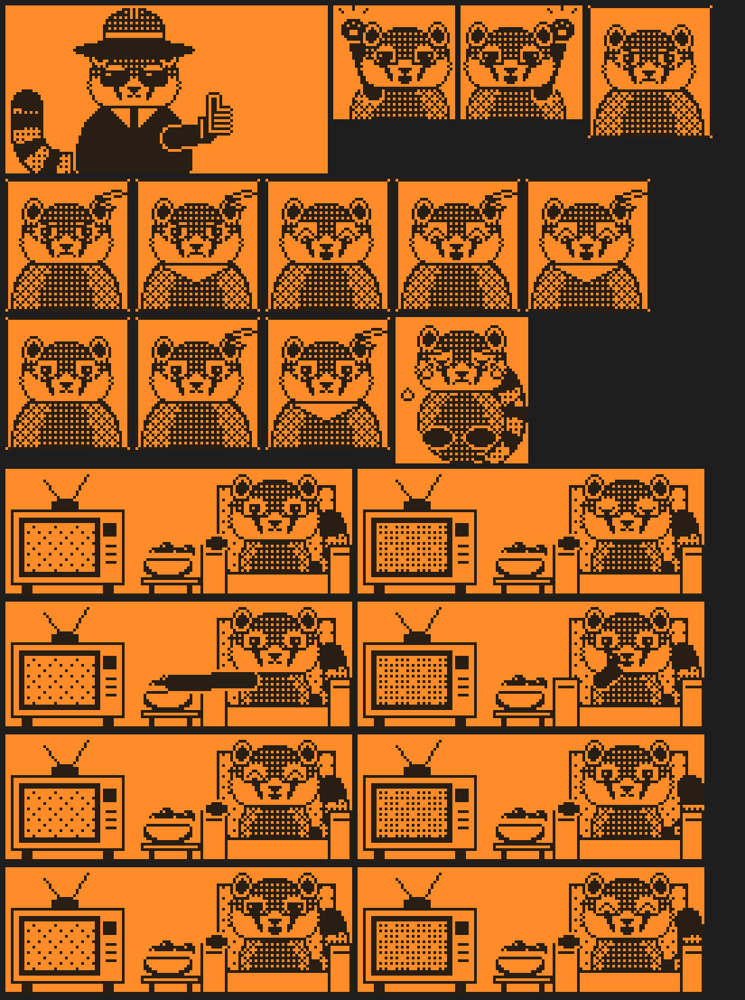
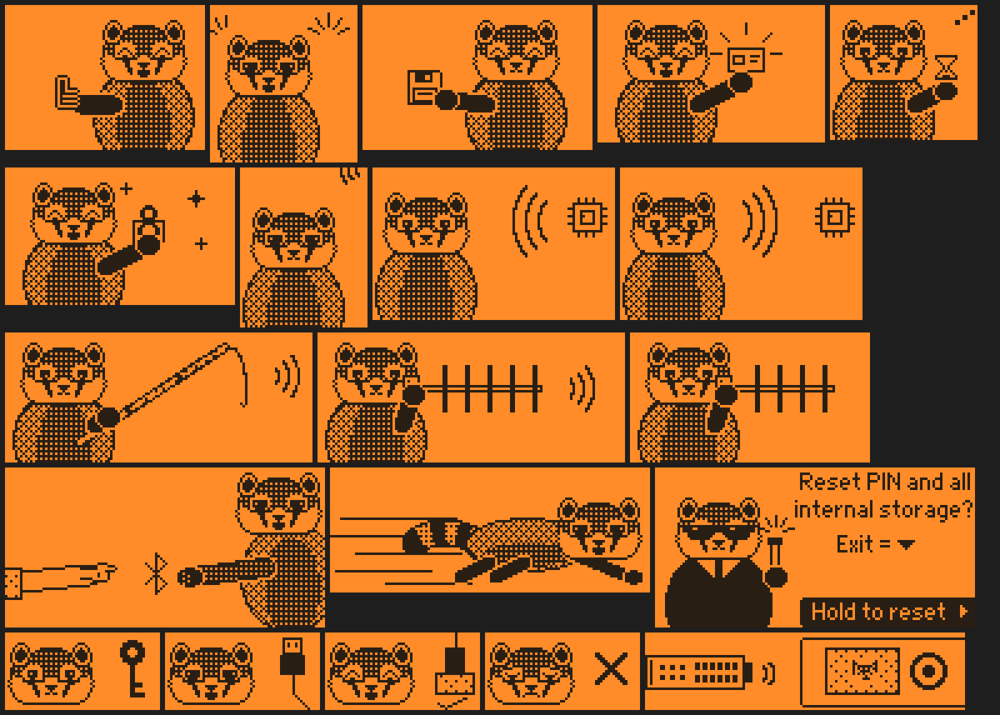

# Red Panda for Flipper Zero

A red panda in place of the Flipper Zero's dolphin, in two parts:

- **Idle animations**: five 128x64 animations for the desktop. They go on the SD card and work on official firmware, Unleashed and Momentum.
- **Firmware pictures**: every other dolphin: the passport, power-off, warnings, the app result screens (saved, read, emulating, Sub-GHz), the Bluetooth, U2F and PIN reset screens, the level-up animation, and the built-in TV and no-SD animations. Official and Unleashed compile these into the firmware, so they need a firmware build. Momentum swaps most of them from its asset pack without a build.

<p>
  
  
</p>
<p>
  
  
</p>
<p>
  
  
</p>
<p>
  
  
</p>
<p>
  
</p>
<p>
  
</p>

Previews are drawn at 3x and 4x, coloured like the Flipper's LCD. Speech bubbles are drawn by the firmware and aren't shown.

## What you get on each firmware

| | Official | Unleashed | Momentum |
|---|---|---|---|
| Idle animations | SD card | SD card, or built in | SD card or asset pack |
| Static pictures (power-off, warnings, result screens, system screens) | Firmware build | Firmware build | Asset pack |
| Passport portrait | Firmware build (9: 3 moods x 3 levels) | Firmware build (9) | Asset pack (3 moods) |
| Level-up animation | Firmware build (2) | Firmware build (2) | Asset pack (1) |
| Built-in TV and no-SD animations | Firmware build | Firmware build | Not swappable by a pack |

## Install: idle animations only (any firmware, no build)

1. On the SD card, rename the existing `dolphin` folder to `dolphin_stock`. That keeps the stock animations for going back, and the firmware ignores the renamed folder. Use qFlipper's file manager, or put the card in a reader.
2. Copy `dist\sd-dolphin\dolphin` to the SD card as `SD/dolphin`.
3. Reboot the Flipper (hold Left + Back). The animation list is read from the SD card, so a reboot is the sure way to pick it up.

To go back, delete `SD/dolphin` and rename `dolphin_stock` back to `dolphin`.

Over USB, `scripts\storage.py send -f dist\sd-dolphin\dolphin /ext/dolphin` from a firmware checkout does the copy. It overwrites only `manifest.txt` and adds the `RP_` folders; the stock folders stay on the card unused. In Git Bash, set `MSYS_NO_PATHCONV=1` first, or it rewrites `/ext/...` into a Windows path. Save a copy of the stock `SD/dolphin/manifest.txt` before you overwrite it (`storage.py receive`); copying it back restores the dolphin.

On official and Unleashed without a custom build:

- **A firmware update brings the dolphin back.** Updates reinstall the stock animations to `SD/dolphin`, so copy the pack again afterwards. The custom build below avoids this.
- **The TV dolphin still appears now and then.** It is compiled into the firmware and always in the rotation (weight 3). The panda animations have weight 9 each, so it is about 1 in 16 animations.

## Install: Momentum (no build)

1. Copy `dist\momentum-asset-pack\RedPanda` to `SD/asset_packs/RedPanda`.
2. On the Flipper, open **Momentum > Interface > Graphics > Asset Pack** and pick **RedPanda**.
3. Back out of the Momentum app to apply it.

That swaps the idle animations, every static dolphin picture, the passport portrait (Momentum's passport has one portrait per mood, so it uses the level 1 pictures) and the level-up animation (Momentum has one, so it gets the level 2 one). Asset packs can't replace the built-in TV and no-SD animations. Pick **Default** to go back.

## Install: official or Unleashed (custom firmware build)

This builds the firmware with every dolphin picture swapped, and with the red panda animations as its SD resources. Installing the update puts the pandas in `SD/dolphin` for you, and later updates of your own build keep them.

You need Git, Python with Pillow (`pip install pillow`), and about 2 GB of disk for the firmware checkout and its toolchain, which `fbt` downloads on first use.

1. Clone the firmware at a release tag. Use the release your Flipper runs, or the one you want to move to:

   ```powershell
   git clone --recursive --branch 1.5.1 https://github.com/flipperdevices/flipperzero-firmware.git
   ```

   or for Unleashed:

   ```powershell
   git clone --recursive --branch unlshd-095 https://github.com/DarkFlippers/unleashed-firmware.git
   ```

2. From this repo, copy the red panda into the checkout. It checks every picture has the same size there before it changes anything, and lists any the firmware doesn't have (official and Unleashed differ by a Sub-GHz picture or two):

   ```powershell
   python tools\firmware.py ..\unleashed-firmware
   ```

   Add `--icons-only` to keep the firmware's stock SD animations.

3. Build the update package in the checkout:

   ```powershell
   .\fbt.cmd COMPACT=1 DEBUG=0 updater_package
   ```

   The package is `dist\f7-C\flipper-z-f7-update-local.tgz`, and the same files unpacked in `dist\f7-C\f7-update-local\`.

4. Install it, either way:
   - **qFlipper**: connect the Flipper, choose **Install from file**, and pick the `.tgz`.
   - **SD card**: copy the `f7-update-local` folder to `SD/update/`. On the Flipper, open **Archive**, browse to `update/f7-update-local`, select `update.fuf` and choose **Run in App**.

To go back, install the stock release through qFlipper or the firmware's own updater.

Checked against official `1.5.1` and Unleashed `unlshd-095`: of the 69 pictures, official has 67 (not the two 123x52 Sub-GHz ones) and Unleashed 68 (not official's `Scanning_short_96x52`), all at the same sizes. Momentum keeps different passport pictures, so `firmware.py` refuses a Momentum checkout; use the asset pack.

## What's in it

### Idle animations

All five are 128x64, 1-bit, 2 frames per second, eligible at every level and mood:

| Animation | What happens | Bubble |
|---|---|---|
| `RP_Idle_128x64` | Sits on a branch, blinks, glances, swishes its ringed tail | "Hi! I'm a red panda!" |
| `RP_Sleep_128x64` | Asleep draped over the branch under the moon, Z's drifting up | "Five more minutes..." |
| `RP_Bamboo_128x64` | Chews a bamboo stalk until the leaves are gone | "Nom nom nom..." |
| `RP_Rawr_128x64` | Stands up with its arms raised, the red panda threat pose | "RAWR!" |
| `RP_Laptop_128x64` | Types on a laptop with a paw-print sticker | "Hacking the bamboo grid" |

### Firmware pictures

Each keeps the name and size of the dolphin it replaces, so no firmware code changes.

| Picture | Where you see it | Red panda |
|---|---|---|
| `Settings/dolph_cry_49x54` | Settings > Power > Power Off | Crying, hugging its tail |
| `Passport/passport_{happy,okay,bad}{1,2,3}_46x49` | Passport | Portrait by mood (happy, okay, bad); level 2 adds a bamboo leaf behind the ear, level 3 a bandana |
| `Dolphin/WarningDolphin_45x42` and `...Flip_45x42` | Lock screen, empty lists, Sub-GHz, NFC, RFID and iButton warnings | Holding up a paw |
| `Dolphin/DolphinMafia_119x62` | "Deleted" after removing a saved key, PIN removed | Fedora, shades, suit, thumbs up |
| `L1_Tv_128x47` (8 frames) | Built-in idle animation | Watching TV from an armchair, snacking on berries |
| `Dolphin/DolphinDone_80x58` | "Done" | Thumbs up |
| `Dolphin/DolphinReadingSuccess_59x63` | Card read | Delighted |
| `Dolphin/DolphinSaved_92x58` | "Saved" | Holding out a floppy disk |
| `Dolphin/DolphinSuccess_91x55`, `iButton/iButtonDolphinVerySuccess_92x55` | Read and write success | Holding up a glowing card, or a key fob |
| `Dolphin/DolphinWait_59x54` | "Please wait" | Watching an hourglass |
| `NFC/NFC_dolphin_emulation_51x64` | NFC emulation | Holding very still |
| `RFID/RFIDDolphinReceive_97x61`, `...Send_97x61` | RFID read and emulate | Waves to and from a chip |
| `SubGhz/Fishing_123x52`, `Scanning_123x52`, `Scanning_short_96x52` | Sub-GHz read | Fishing with a bamboo rod; pointing an antenna |
| `BLE/BLE_Pairing_128x64` | Bluetooth pairing PIN | A hand and a paw reaching for the Bluetooth sign |
| `Common/DFU_128x50` | Update and recovery mode | Dashing |
| `ErasePin/Erase_pin_128x64` | Reset PIN | Shades, suit and a memory-wipe flasher |
| `U2F/Auth_62x31`, `Connect_me`, `Connected`, `Error` | U2F | Head with a key, a plug, plugged in, a cross |
| `Infrared/InfraredLearnShort_128x31` | Infrared learn | A Flipper showing a tiny panda |
| `Animations/Levelup1_128x64`, `Levelup2_128x64` (11 frames each) | Level up | A burst of leaves into the new look, "NEW LEVEL!!!" |
| `L1_NoSd_128x49` (6 frames) | No SD card | Reaching for an SD card |

The TV and no-SD animations keep upstream's `meta.txt` (timing and bubbles), and the level-up animations their `frame_rate`. The TV animation keeps its name because the firmware falls back to it by name.

Text baked into pictures (the PIN reset screen, "NEW LEVEL!!!", the SD card) is drawn with this repo's own pixel font, `tools/pixfont.py`, so nothing here is copied from the firmware's art.

## Layout

```
art\                          firmware-neutral source
  RP_*\, manifest.txt         idle animations: frame_N.png + meta.txt (standard Flipper format)
  firmware\                   firmware pictures, at their path in the official and
                              Unleashed source trees
dist\sd-dolphin\dolphin\      idle animations compiled for SD/dolphin
dist\momentum-asset-pack\     Momentum asset pack: Anims\ and Icons\
preview\                      contact sheets and GIFs, coloured like the LCD
tools\
  pcraft.py                   drives PhotoCraft headless (photocraft-cli serve)
  panda.py                    the red panda: head sprite, expressions, poses, tail, props
  build.py                    defines the idle animations, renders art\RP_*
  icons.py                    renders the firmware pictures to art\firmware (Phase 1 scenes)
  scenes2.py                  the rest: result, system, level-up and no-SD scenes
  pixfont.py                  a small pixel font for text inside pictures
  pack.py                     compiles art\ into dist\ (SD card and Momentum)
  firmware.py                 copies art\ into an official or Unleashed checkout
```

## How the art is made

The frames are drawn in PhotoCraft (ArtCraft suite) through its headless engine, `photocraft-cli serve`. `panda.py` describes each scene as shapes and pixel sprites. `pcraft.py` turns each shape into a PhotoCraft selection plus Edit > Fill, then runs Image > Mode > Bitmap (pattern dither) to make the 1-bit frame and saves the PNG. Fur is filled in grey, which the pattern dither turns into a fixed texture, so it doesn't shimmer between frames.

The PNGs in `art\` open in PhotoCraft for hand edits. Run `pack.py` afterwards. Running `build.py` or `icons.py` again regenerates their PNGs from the scripts and overwrites hand edits.

## Rebuild

`build.py` and `icons.py` need Pillow and PhotoCraft at `C:\Program Files\PhotoCraft`. `pack.py` needs Pillow and heatshrink2, and no firmware checkout.

```powershell
pip install pillow heatshrink2
```

```powershell
python tools\build.py
```

```powershell
python tools\icons.py
```

```powershell
python tools\pack.py
```

A Flipper firmware checkout's bundled toolchain Python (`toolchain\x86_64-windows\python\python.exe`) already has both libraries.

## Checks done

Source checked: official `1.5.1`, Unleashed `unlshd-095`, Momentum `e1784e7` (`mntm-012`).

- All three load idle animations from a `manifest.txt` plus `<name>/meta.txt` and `<name>/frame_N.bm`. Official and Unleashed read them from `/ext/dolphin`. Momentum reads the same folder when Asset Pack is Default (`animation_storage.c` in each).
- `pack.py` converts frames the same way as official `scripts/flipper/assets/icon.py` (Unleashed's copy is identical). Its output is byte-identical to Momentum's `asset_packer.py` for all 27 animation frames, all 26 static icons and the animated level-up icon.
- Every `.bm` decodes back to its PNG pixel for pixel and is within the firmware's size limit.
- Each `meta.txt` follows the loader's rules: fields in strict order, the frame order count equal to passive plus active frames, and bubble slots starting at 0 and ascending.
- Momentum swaps icons from `asset_packs/<pack>/Icons/<Category>/<name>.bmx` (`lib/momentum/asset_packs.c`); the pack uses those names.
- Idle animations checked on a Flipper Zero running Unleashed `unlshd-095`, installed to `SD/dolphin`, on 2026-11-25.
- Firmware pictures checked on a Flipper Zero running a custom Unleashed `unlshd-095` build made with `tools/firmware.py`, on 2026-11-26: power-off, passport, lock-screen warning, Deleted screen, the TV animation, and the idle animations installed by the update itself.
- The Momentum asset pack's pictures and an official firmware build are checked against source, not yet on a device.

## Licence

MIT, see [LICENSE](LICENSE). That covers the artwork, the compiled packs and the tools. Use, change, share or sell them freely; just keep the copyright notice with any copies.
