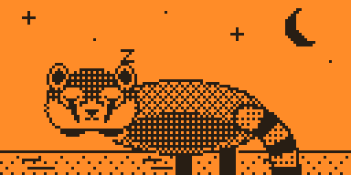
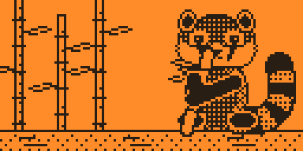
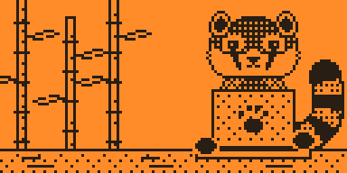

# Red Panda idle animations for Flipper Zero

Five red panda animations that replace the dolphin's idle animations. One package works on official firmware, Unleashed, and Momentum. All three read idle animations from `SD/dolphin/` in the same format.

<p>
  
  
</p>
<p>
  
  
</p>
<p>
  
</p>

Previews are drawn at 3x, coloured like the Flipper's LCD. Speech bubbles are drawn by the firmware and aren't shown.

## Install (official or Unleashed)

1. On the SD card, rename the existing `dolphin` folder to `dolphin_stock`. That keeps the stock animations for going back, and the firmware ignores the renamed folder. Use qFlipper's file manager, or put the card in a reader.
2. Copy `dist\sd-dolphin\dolphin` to the SD card as `SD/dolphin`.
3. Reboot the Flipper (hold Left + Back). The animation list is read from the SD card, so a reboot is the sure way to pick it up.

To go back, delete `SD/dolphin` and rename `dolphin_stock` back to `dolphin`.

Over USB, `scripts\storage.py send -f dist\sd-dolphin\dolphin /ext/dolphin` from a firmware checkout does the copy. It overwrites only `manifest.txt` and adds the `RP_` folders; the stock folders stay on the card unused. In Git Bash, set `MSYS_NO_PATHCONV=1` first, or it rewrites `/ext/...` into a Windows path. Save a copy of the stock `SD/dolphin/manifest.txt` before you overwrite it (`storage.py receive`); copying it back restores the dolphin.

**After a firmware update, copy the pack again.** Official and Unleashed ship their stock dolphin animations as SD-card resources, and an update reinstalls them, which brings back the stock `SD/dolphin/manifest.txt`. That comes from their build scripts (`assets/SConscript`); it hasn't been observed on a device yet.

**The TV dolphin still appears now and then.** Both firmwares compile `L1_Tv_128x47` into the firmware itself and always add it to the idle rotation (weight 3). An SD card can't remove it; only a custom firmware build can. The panda animations have weight 9 each, so the TV dolphin is about 1 in 16 animations.

## Install (Momentum)

Either of these works:

- Use the `SD/dolphin` package above with **Momentum > Interface > Graphics > Asset Pack** set to **Default**. Momentum falls back to `SD/dolphin` when no pack is chosen.
- Or copy `dist\momentum-asset-pack\RedPanda` to `SD/asset_packs/RedPanda`, then pick **RedPanda** in **Momentum > Interface > Graphics > Asset Pack** and back out of the app to apply it.

## What's in it

All five are 128x64, 1-bit, 2 frames per second, eligible at every level and mood:

| Animation | What happens | Bubble |
|---|---|---|
| `RP_Idle_128x64` | Sits on a branch, blinks, glances, swishes its ringed tail | "Hi! I'm a red panda!" |
| `RP_Sleep_128x64` | Asleep draped over the branch under the moon, Z's drifting up | "Five more minutes..." |
| `RP_Bamboo_128x64` | Chews a bamboo stalk until the leaves are gone | "Nom nom nom..." |
| `RP_Rawr_128x64` | Stands up with its arms raised, the red panda threat pose | "RAWR!" |
| `RP_Laptop_128x64` | Types on a laptop with a paw-print sticker | "Hacking the bamboo grid" |

Only the idle animations change. Passport and other screen icons stay stock.

`preview\*.gif` plays each animation in its real frame order. `preview\*.png` shows every frame.

## Layout

```
art\                          firmware-neutral source: manifest.txt, and per animation
                              frame_N.png + meta.txt (standard Flipper dolphin format)
dist\sd-dolphin\dolphin\      compiled for SD/dolphin (official, Unleashed, Momentum Default)
dist\momentum-asset-pack\     compiled as a Momentum asset pack
preview\                      contact sheets and GIFs, coloured like the LCD
tools\
  pcraft.py                   drives PhotoCraft headless (photocraft-cli serve)
  panda.py                    the red panda: head sprite, poses, tail, props
  build.py                    defines the animations, renders art\ with PhotoCraft
  pack.py                     compiles art\ into dist\ for each firmware
```

## How the art is made

The frames are drawn in PhotoCraft (ArtCraft suite) through its headless engine, `photocraft-cli serve`. `panda.py` describes each scene as shapes and pixel sprites. `pcraft.py` turns each shape into a PhotoCraft selection plus Edit > Fill, then runs Image > Mode > Bitmap (pattern dither) to make the 1-bit frame and saves the PNG. Fur is filled in grey, which the pattern dither turns into a fixed texture, so it doesn't shimmer between frames.

The PNGs in `art\` open in PhotoCraft for hand edits. Run `pack.py` afterwards. Running `build.py` again regenerates every PNG from the scripts and overwrites hand edits.

## Rebuild

`build.py` needs Pillow and PhotoCraft at `C:\Program Files\PhotoCraft`. `pack.py` needs Pillow and heatshrink2, and no firmware checkout.

```powershell
pip install pillow heatshrink2
```

```powershell
python tools\build.py
```

```powershell
python tools\pack.py
```

A Flipper firmware checkout's bundled toolchain Python (`toolchain\x86_64-windows\python\python.exe`) already has both libraries.

## Checks done

Source checked: official `1.5.1`, Unleashed `unlshd-095`, Momentum `e1784e7` (`mntm-012`).

- All three load idle animations from a `manifest.txt` plus `<name>/meta.txt` and `<name>/frame_N.bm`. Official and Unleashed read them from `/ext/dolphin`. Momentum reads the same folder when Asset Pack is Default (`animation_storage.c` in each).
- `pack.py` converts frames the same way as official `scripts/flipper/assets/icon.py` (Unleashed's copy is identical). Its output is byte-identical to Momentum's `asset_packer.py` for all 27 frames.
- Every `.bm` decodes back to its PNG pixel for pixel and is within the firmware's size limit.
- Each `meta.txt` follows the loader's rules: fields in strict order, the frame order count equal to passive plus active frames, and bubble slots starting at 0 and ascending.
- Checked on a Flipper Zero running Unleashed `unlshd-095`, installed to `SD/dolphin`, on 2026-11-25.
